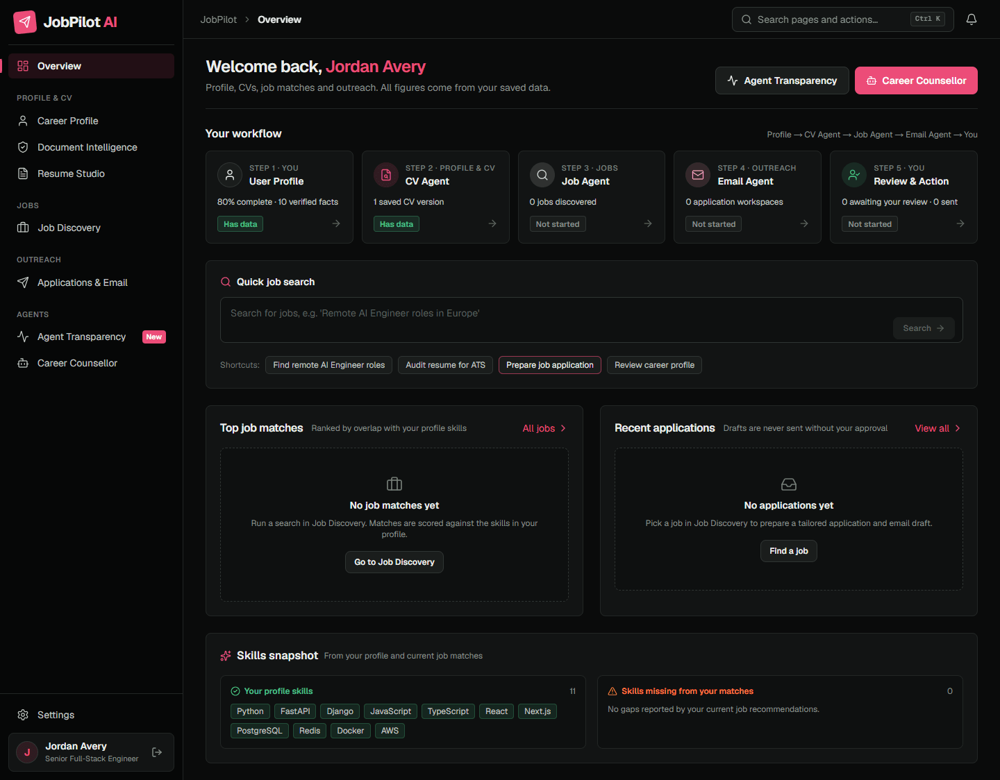
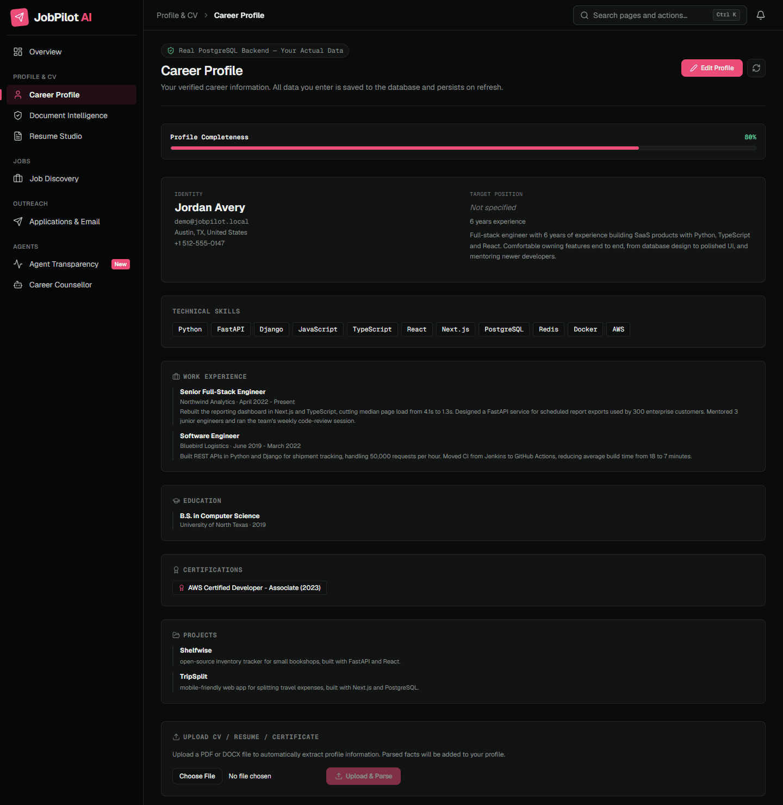
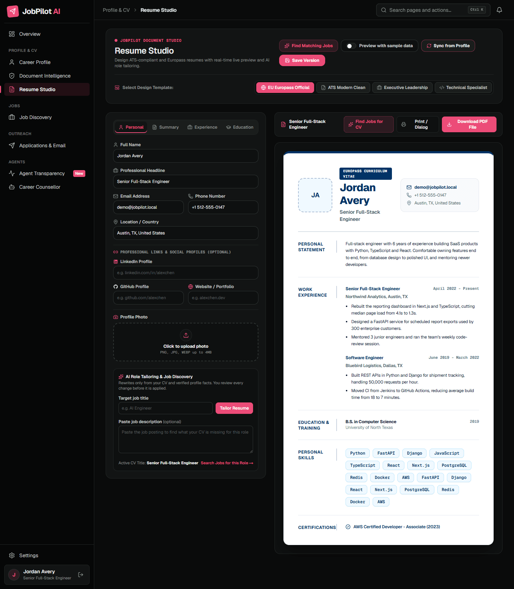
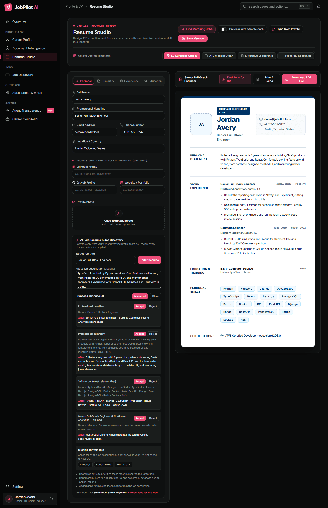
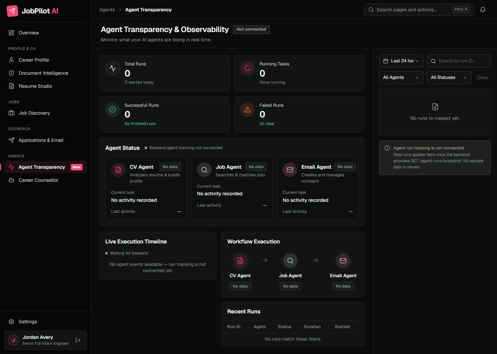
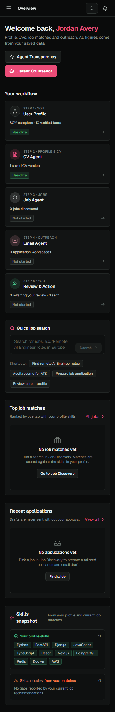

# JobPilot AI

> A multi-agent career platform: upload your CV, find live jobs that match it, and get a fact-checked application email with your CV attached, ready as a Gmail draft. Every agent step is visible live.

**Maintained by [Maryam Arooj](https://github.com/Maryam-Arooj)**



---

## What it does

Three agents work as one pipeline. One click, **Apply with AI**, runs them in order and stops for your approval.

| Agent | What it does | Live services |
|---|---|---|
| **CV Agent** | Reads your CV (PDF, DOCX, text, and designed/scanned PDFs through local OCR) in seconds, then improves the result with AI in the background. Every value must appear in your CV; you confirm each fact before it is saved. Builds tailored resumes and exports PDF/DOCX. | Gemini (NVIDIA NIM fallback), RapidOCR |
| **Job Agent** | Searches live jobs for the role and location in your CV, by country (Pakistan, UAE, UK, US, ...) or remote, from two providers in parallel. Cleans locations (city, province, country) and scores each job honestly against your skills, showing matched skills and gaps. | SerpAPI Google Jobs, Apify LinkedIn Jobs |
| **Email Agent** | Finds the company's official website, reads it and summarises only what is on the page. Writes the application email with AI and fact-checks it (removes any number, skill or company claim not in your CV, the job or the website). Finds a **real** recruiter email from 8 sources, attaches your CV, and creates a Gmail **draft** only after you approve. | Gemini, SerpAPI, Firecrawl, Apify, Gmail API |

**Principle: real data only.** Nothing is invented: no fake jobs, scores, company facts, CV values or email addresses. If a provider fails or a company publishes no email, the app says so and shows the honest alternative (for example the job's Apply link).

### Apply with AI (one click)

1. **CV Agent** reads your CV.
2. **Job Agent** finds live jobs for it (your CV location, Pakistan, or Remote).
3. **Email Agent** searches real recruiter emails for the top 10 matches.
4. **Job Agent** picks the best-matching job that has a recruiter email.
5. **Email Agent** researches the company, writes the email, fills the recipient and attaches your CV.
6. **You** review the email and approve the Gmail draft. Nothing is ever sent automatically.

### Live Agent Transparency dashboard

Every agent run is recorded: status, current step, each external call (Gemini, SerpAPI, Apify, Firecrawl, Gmail), timings, warnings and results, with secrets redacted. The dashboard refreshes every few seconds while an agent is running.

## Screenshots

| | |
|---|---|
|  |  |
| Overview with the agent workflow | Career profile |
|  |  |
| Resume Studio with live CV preview | Tailor Resume: proposed changes and skill gaps |
|  |  |
| Agent Transparency | Overview on mobile |

## How the recipient email is found

The Email Agent only uses addresses that are published somewhere public, and shows where each one was found:

1. an email written in the job posting
2. the job's own pages (job page, Apply page)
3. public LinkedIn posts about the job or company
4. the company website found on its LinkedIn page
5. the company's own pages (home, contact, careers, about)
6. a deep crawl of the company site (Apify Contact Details Scraper)
7. Google results on the company's own domain
8. a whole-web search (Firecrawl)

The Jobs page can show **only jobs with a recruiter email**. Large companies often publish none and take applications only through their careers site; for those the app shows the Apply link and the recruiter's LinkedIn profile instead of guessing an address.

## Tech stack

- **Frontend:** Next.js 16 (App Router, Turbopack), React 19, Tailwind CSS v4
- **Backend:** FastAPI, SQLAlchemy, PostgreSQL 16
- **AI:** Google Gemini (OpenAI-compatible endpoint), NVIDIA NIM as fallback; RapidOCR for scanned CVs
- **Data providers:** SerpAPI (Google Jobs, Google search), Apify (LinkedIn jobs, contact crawl), Firecrawl (scrape, search)
- **Email:** Gmail API via Google OAuth (drafts only, signed OAuth state)

## Getting started

### Prerequisites

- Python 3.11+ (tested on 3.13), Node.js 20+, PostgreSQL 16
- API keys: Gemini (or NVIDIA NIM), SerpAPI, Apify, Firecrawl, and a Google OAuth client with the Gmail API enabled

### 1. Clone

```bash
git clone https://github.com/Maryam-Arooj/JobPilot-AI.git
cd JobPilot-AI
```

### 2. Database

```sql
CREATE DATABASE jobpilot_v2;
```
Tables are created automatically on first start.

### 3. Backend

```bash
python -m venv backend/.venv
# Windows: backend\.venv\Scripts\activate    macOS/Linux: source backend/.venv/bin/activate
pip install -r backend/requirements.txt
cp backend/.env.example backend/.env        # then fill in your values
python backend/scripts/check_providers.py   # optional: checks every key without printing it
python -m uvicorn backend.api.main:app --reload --port 8000
```

Check: http://127.0.0.1:8000/health

### 4. Frontend

```bash
cd frontend
npm install
echo NEXT_PUBLIC_API_URL=http://127.0.0.1:8000 > .env
npm run dev
```

Open http://localhost:3000. On Windows you can also start both with `start-servers.bat`.

## Configuration

`backend/.env` (see `backend/.env.example` for every option):

| Variable | Purpose |
|---|---|
| `DATABASE_URL` | e.g. `postgresql://postgres:<password>@localhost:5432/jobpilot_v2` |
| `SECRET_KEY` | Long random string that signs login tokens and the Gmail OAuth state |
| `GEMINI_API_KEY`, `GEMINI_MODEL` | Primary AI model |
| `OPENAI_API_KEY`, `OPENAI_BASE_URL`, `NVIDIA_MODEL` | NVIDIA NIM fallback |
| `SERPAPI_KEY` | Google Jobs and Google search |
| `APIFY_API_TOKEN`, `APIFY_ACTOR_ID` | LinkedIn jobs; the same token runs the contact crawl |
| `FIRECRAWL_API_KEY` | Company websites and web search |
| `GOOGLE_CLIENT_ID`, `GOOGLE_CLIENT_SECRET`, `GOOGLE_REDIRECT_URI` | Gmail OAuth; redirect `http://localhost:3000/api/auth/callback/google` |
| `HUNTER_API_KEY` or `TOMBA_API_KEY` + `TOMBA_SECRET` | Optional extra email sources (need a work email to sign up) |

> Never commit `.env` files. They are listed in `.gitignore`.

## Project structure

```
backend/
  ai_agents/     CV (profile), job analysis/match, email writer + fact checker, company research
  api/           FastAPI routers: auth, documents, profiles, resumes, jobs, applications, companies,
                 gmail, agent-runs (live dashboard), pipeline (Apply with AI)
  providers/     SerpAPI, Apify, Firecrawl, company research + recipient finder, Gmail
  services/      LLM client, agent-run tracking, job matching, locations, recipients, pipeline
  scripts/       provider checks and live verification (verify_task1..5.py, verify_emails.py)
  tests/
frontend/
  src/app/       overview, confirm (CV upload), profile, resume studio, jobs, applications, agent transparency
  src/components/ shared UI, ApplyWithAI, LiveAgentActivity
docs/            architecture notes, demo script
```

## Running tests

```bash
backend/.venv/Scripts/python -m pytest backend/tests      # Windows
backend/.venv/bin/python -m pytest backend/tests          # macOS/Linux
```

## License

All rights reserved. See [LICENSE](LICENSE) for the full terms.
